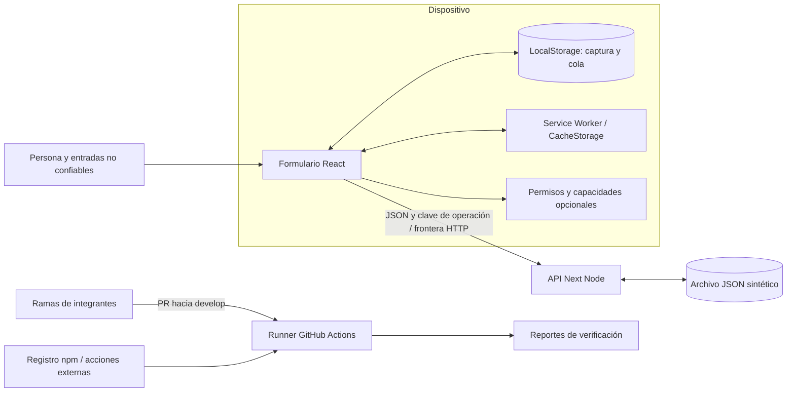

# Modelo de amenazas · Semana 9

Responsable: Hector Ulises Cacho Gonzalez. Base revisada: `c7a8fe7a8e03f73143046e5c66cc5037cf00595f` de `develop`, con la aportación de Fátima integrada mediante PR #30 y #31. Fecha: 2026-10-30. Alcance académico con datos sintéticos; este documento no acredita aptitud para producción.

## Sistema, activos y supuestos

La PWA Next/React permite capturar laboratorio y resumen, guardarlos offline y enviar una operación al reconectar. Se protegen integridad y disponibilidad de inspecciones, confidencialidad del dispositivo, permisos de cámara/ubicación/notificaciones y credenciales del repositorio/CI.

- La interfaz vive en `src/components/inspection-capture.tsx`; las capturas y la cola están en LocalStorage (`utt_pwa_inspections`, `utt_pwa_sync_queue`). Ese almacenamiento no es secreto ni confiable.
- `POST /api/inspecciones` recibe JSON y una `Idempotency-Key`; `GET` devuelve los registros del almacén. `src/app/api/inspecciones/route.ts` usa `.pwa-data/inspections.json`, con ruta alternativa mediante `PWA_SYNTHETIC_STORE`.
- `public/sw.js` conserva el shell y recursos del mismo origen. Excluye `/api/` y peticiones RSC, pero conserva documentos de navegación; hay que revisar la estrategia antes de introducir contenido personal.
- `device-actions.tsx` pide capacidades tras una acción. El archivo y las coordenadas se usan en la sesión; el formulario actual no los incorpora al JSON persistido. Un nombre de archivo o unas coordenadas mostradas siguen siendo datos potencialmente personales.
- No hay cuentas, sesiones, roles, secretos de aplicación ni servicio de analítica implementados en el código revisado. No se presupone ninguna protección de un proxy externo no incluido en el repositorio.
- Los nombres del listado de ejemplo son datos de demostración. El uso real debe evitar nombres, ubicaciones o fotografías de personas. El inventario detallado y `robots.txt` corresponden a Janeth y requieren revisión en su PR.

## Flujos y fronteras de confianza

Fronteras: entrada→interfaz (validar y renderizar texto), navegador→servidor (no confiar en validación del cliente), proceso→disco (permisos/concurrencia), contribución→runner (código ajeno sin secretos ni permiso de escritura). Cualquier script del mismo origen o persona con acceso al perfil del navegador puede modificar la cola.

## Amenazas priorizadas (STRIDE)

Probabilidad e impacto: 1 bajo, 2 medio, 3 alto. Producto 6–9 = alta, 3–4 = media, 1–2 = baja. Estimaciones de ingeniería sobre esta demostración, no mediciones. S: suplantación, T: alteración, R: repudio, I: divulgación, D: denegación, E: elevación. El riesgo residual distingue controles reales de mejoras pendientes.

| ID / categoría | Escenario y activo | P×I | Control observado y comprobación | Riesgo residual / siguiente acción / responsable propuesto |
| --- | --- | --- | --- | --- |
| A1 S/E | Un cliente anónimo lee o escribe inspecciones ajenas | 3×3 alta | API solo admite IDs `SYNTH-` y campos seleccionados. Es validación de formato, no identidad. Inspección de `route.ts` | Alto: no hay autenticación ni autorización. Equipo/backend: diseñarlas antes de usar datos reales |
| A2 T/I | Texto malicioso ejecuta JavaScript en la captura | 2×3 alta | Fátima escapa `notes/findings`; React renderiza laboratorio/resumen como texto. `tests/security.spec.ts` y `tests/e2e/security-boundaries.spec.ts` | Medio: el sanitizador no cubre todos los campos ni todos los contextos. Fátima/equipo: mantener escape por contexto y evitar HTML sin procesar |
| A3 T/I | Un script inyectado evade CSP | 2×3 alta | `next.config.mjs`: CSP `default-src 'self'`, `img-src 'self' data:`, `nosniff`. E2E verifica cabeceras reales y rechazo de un script externo | Alto: `script-src` permite `unsafe-inline` y `unsafe-eval`; faltan `frame-ancestors`, `base-uri`, `object-src`. Fátima/equipo: endurecer con nonces compatibles con Next y probar modo producción/offline |
| A4 T | Cola manipulada cambia payload o endpoint y envía información a otro destino | 2×3 alta | IDs estables y deduplicación reducen reintentos duplicados. `tests/integration/sync.spec.mjs` | Alto: no se valida el esquema/endpoint de una cola ya persistida. Equipo: lista de endpoints locales, validación estructural y por operación |
| A5 T | Repetir una operación o reutilizar un ID sobrescribe información | 2×2 media | Misma clave/contenido se deduplica y contenido distinto con la misma clave retorna 409. `tests/e2e/api-idempotencia.spec.ts` | Medio: otra clave puede sobrescribir el mismo ID; `updatedAt` omitido puede generar huellas distintas al reintentar. Equipo/backend: conflicto por versión/ID y representación estable |
| A6 R | No puede acreditarse quién creó o alteró una captura | 3×2 alta | SHA/Actions acreditan una revisión de código, no autoría de datos. Inspección de API/almacén | Alto: sin usuario autenticado ni bitácora inmutable. Equipo: auditoría mínima sin registrar contenido sensible |
| A7 I | Dispositivo compartido o caché expone información tras cerrar la página | 2×3 alta | API usa `Cache-Control: no-store` y SW excluye API. E2E comprueba cabecera; permisos son opcionales | Alto con datos reales: LocalStorage sin cifrado ni expiración; caché de navegación sin política por usuario. Janeth/equipo: retención/borrado explícitos y revisar inventario |
| A8 D | Muchas peticiones o cuerpos enormes agotan memoria/disco | 2×3 alta | POST rechaza texto mayor de 32768 caracteres y limita laboratorio/resumen. E2E verifica 413/400 | Alto: lee todo el cuerpo antes de medir, no limita bytes en streaming, frecuencia, registros ni operaciones. Equipo/backend: límites en proxy/stream y cuotas |
| A9 D/T | Fallos de red o pestañas simultáneas pierden trabajo | 2×2 media | Persistencia offline y estado sincronizado solo tras HTTP exitoso; integración/E2E de Semana 8 | Medio: descarte de cola al tercer fallo, sin bloqueo entre pestañas; JSON serializa solo dentro de un proceso. Equipo: cola de errores, transacciones/BD y control de concurrencia |
| A10 I/E | Dependencia o PR malicioso roba credenciales del runner | 2×3 alta | Nuevo workflow usa `pull_request`, token de lectura, checkout sin credenciales persistentes, acciones fijadas por SHA, sin secretos ni despliegue | Medio: dependencias ejecutan código en instalación/build. Ulises/equipo: revisar lockfile y auditoría; actualizar dependencias mediante otro PR probado |
| A11 I | Cámara, ubicación o notificación revela contexto personal | 2×2 media | Solo petición por clic, sin micrófono y fallback al negar; `tests/capabilities.spec.ts` y E2E de permisos | Medio: permiso del navegador no equivale a consentimiento para cualquier uso. Janeth/equipo: finalidad, retención y contenido mínimo de avisos |

## Decisiones y alternativas

1. Conservar los controles de Fátima y documentar su alcance real. No sustituir su trabajo por una CSP estricta improvisada: Next y la recarga offline requieren validar nonces y cachés juntos. La CSP actual permite inline/eval, por lo que no se presenta como protección completa contra XSS.
2. Evaluar HTTP y DOM reales además del sanitizador unitario. Probar una función que escapa caracteres no demuestra que la aplicación entera impida XSS; los E2E comprueban contexto de texto, cabeceras y un recurso externo bloqueado.
3. Mantener la API sintética y el archivo JSON para la demostración. Incorporar identidad, base de datos y cifrado constituye un cambio de arquitectura pendiente del equipo. `robots.txt` limita rastreo cooperativo; nunca sustituye autenticación ni evita acceso directo.
4. CI valida la contribución en una rama propia y un PR dirigido a `develop`. No publica aplicación ni fusiona automáticamente. Se conservan los workflows anteriores para detectar regresiones.
5. Auditoría de dependencias visible pero informativa en esta entrega: se conserva el JSON y se muestra advertencia si falla. No se ocultan vulnerabilidades conocidas ni se afirma que un check verde certifique seguridad. El equipo debe resolver y convertirla en requisito bloqueante antes de producción.

## Diagnóstico, comprobaciones y fallos

- La base integrada ejecuta 82 pruebas Node, incluidas las 2 de Fátima, sin fallos. Su prueba demuestra escape de etiquetas; no simula todas las variantes XSS ni un navegador real.
- Hallazgos por revisión, sin explotar servidores externos: A1 (API pública sin identidad), A3 (CSP permisiva), A4 (endpoint controlado por almacenamiento) y A8 (límite aplicado tras leer el cuerpo). Son pendientes explícitos, no correcciones implementadas por este PR.
- Auditoría inicial `npm audit --omit=dev --json` del 30-10-2026: 3 dependencias vulnerables (Next crítica; postcss y source-map-js altas). El registro propone Next 16.4.3 como arreglo mayor para Next/postcss; no se aplica automáticamente sobre Next 14.2.35. Se requiere revisar advisories, migrar en otro PR y repetir toda la verificación. El resultado cambia con el registro y se conserva como evidencia fechada, no como diagnóstico permanente.
- Reproducción sintética: `npm ci`, `npx playwright install chromium`, `npm run test:security`, `npm run build`, `npm run test:e2e -- tests/e2e/security-boundaries.spec.ts`, `make verify` (Windows sin make: `npm run verify`). Auditoría: `npm audit --omit=dev --json`; su salida no cero debe conservarse y analizarse.
- Workflow: `.github/workflows/week-09-w09-security-privacy.yml`. Los fallos de instalación, pruebas o verificación bloquean; los hallazgos de auditoría se advierten y conservan aparte. `reports/`, cobertura, trazas y JSON de auditoría son artefactos, no evidencia de revisión humana.
- Revisar este modelo al cambiar autenticación, campos capturados, sincronización, Service Worker, dependencias o despliegue. Ulises mantiene el modelo/CI; responsables de mitigaciones de equipo son propuestas sujetas al acuerdo entre integrantes.

## Referencias de método

- [OWASP Threat Modeling Cheat Sheet](https://cheatsheetseries.owasp.org/cheatsheets/Threat_Modeling_Cheat_Sheet.html): modelar flujos/fronteras, identificar riesgos, mitigar y revisar. La matriz anterior es nuestro análisis del código.
- [GitHub: Security hardening for GitHub Actions](https://docs.github.com/en/actions/security-for-github-actions/security-guides/security-hardening-for-github-actions): permisos mínimos, entradas no confiables y acciones fijadas por commit.

Documento preparado con Codex; Ulises debe revisar y comprender sus decisiones y comprobarlas antes de atribuirse validación humana. El inventario de privacidad de Janeth es una dependencia separada y no se declara terminado aquí.
